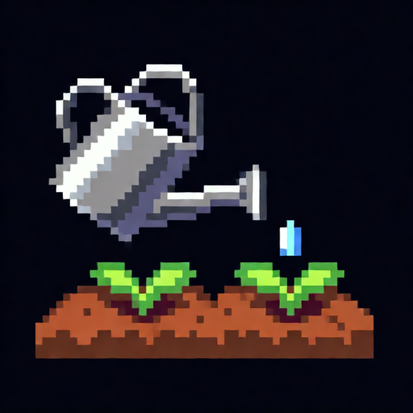
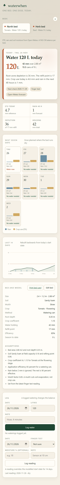
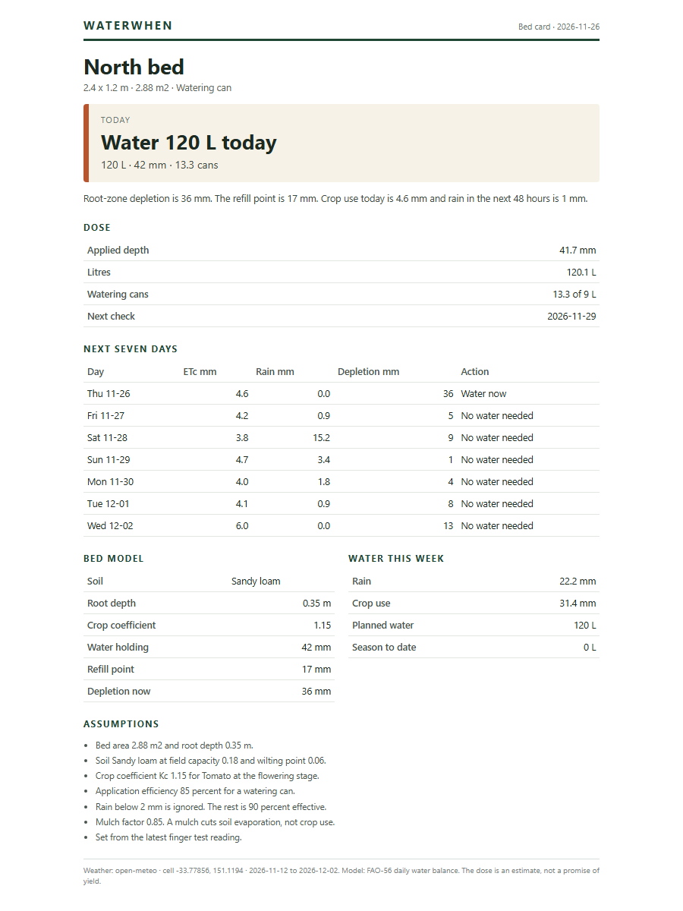

# waterwhen



An irrigation scheduler for veggie beds. Open ET0, rain and soil moisture become one water dose in millimetres and litres.

[](LICENSE)
[](#tests)
[](https://www.python.org/)
[](#quick-start)

## The problem

A timer waters on a fixed schedule. It cannot see the weather. So a cool, wet week drowns the roots, and the next hot week wilts the crop.

A veggie bed needs a water balance. The inputs are public and free: reference evapotranspiration, rainfall and modelled soil moisture. The answer a gardener needs is one number in litres, and the date of the next check.

## What it does

Give the app a bed size, a soil, a crop and a growth stage. It fetches a 21-day window from Open-Meteo. That window holds 14 past days and a 7-day forecast. Then it runs a daily FAO-56 water balance and returns one action.

The four actions are `water_now`, `hold_for_rain`, `check` and `wait`. Each action carries a reason, in plain words.

A 2.4 by 1.2 m tomato bed on sandy loam with straw mulch returns:

- **Water 120 L today.** Depletion is 36 mm of 42 mm, and the refill point is 17 mm.
- **42 mm applied.** That is 13.3 cans of 9 litres.
- **Hold for rain.** With 34 mm of rain forecast, the same bed returns 0 litres.
- **96 L, 60 minutes** for a drip bed at 1.6 L/min.

## Features

- **One action, one reason.** The card states the dose and names the depletion, the refill point and the rain forecast behind it.
- **FAO-56 balance, not a timer.** Total available water, refill point, crop use and effective rain run per bed and per day.
- **Rain-aware advice.** If most of the deficit is forecast within 48 hours, the app holds the dose and tells you to check after the rain.
- **Read your own bed.** A finger test or a sensor reading overrides the modelled start state for 14 days.
- **Split doses on sand.** A large dose on a sandy soil splits into two applications, so the water does not leach past the roots.
- **No dependencies.** Python standard library, SQLite and hand-drawn SVG charts. One page, no build step.

## Quick start

```bash
git clone https://github.com/fuleinist/waterwhen
cd waterwhen
python -m waterwhen --port 8772
```

Open <http://127.0.0.1:8772>. Add a bed and the app returns today's action.

Options:

```bash
python -m waterwhen --port 8772 --db data/waterwhen.db   # choose a database
python -m waterwhen --offline                            # modelled weather, no network
```

Run the tests:

```bash
python -m unittest discover -s tests
```

Check the model against hand arithmetic:

```bash
python scripts/verify.py
```

Capture real screenshots (needs Playwright):

```bash
python scripts/capture.py
```

## Screenshots


The action card, the seven-day outlook and the 14-day history. North bed needs 120 L today, and the bed card is one click away.



The same view at 390 px. The bed rail scrolls sideways and the card stacks.



The printable A4 bed card. It carries the same numbers as the screen.

## How the model works

The balance is a daily FAO-56 form. Depletion `Dr` is the water missing from the root zone, in millimetres. Zero is field capacity. Total available water is the wilting point.

```
TAW  = (theta_fc - theta_wp) * 1000 * root_depth_m
RAW  = p * TAW
ETc  = ET0 * Kc * mulch_factor
Peff = max(0, rain - 2.0) * 0.90
Dr_t = clamp(Dr_{t-1} + ETc - Peff - I_t, 0, TAW)
```

The dose refills the root zone to field capacity. It divides the deficit by the application efficiency of the watering method.

One millimetre over one square metre is one litre. That identity is the whole user interface.

## Data sources

- [Open-Meteo Forecast API](https://open-meteo.com/en/docs) — daily ET0, rainfall and temperature, plus hourly soil moisture at 0 to 7 cm and 7 to 28 cm. Free, no key.
- [Open-Meteo Geocoding API](https://open-meteo.com/en/docs/geocoding-api) — place search for the bed location. Free, no key.
- [FAO-56, Irrigation and Drainage Paper 56](https://www.fao.org/3/x0490e/x0490e00.htm) — soil water characteristics (Table 19), crop coefficients (Table 12), depletion fractions (Table 22) and rooting depths.

Mulch factors and application efficiencies are documented approximations. They are not published FAO values. Each table carries a note in `waterwhen/soils.py`.

## Limits

- Open-Meteo soil moisture is a modelled 5 to 25 km grid. It is not a bed sensor. The app seeds the balance from it, and a reading corrects it.
- Rainfall is uneven. The app shows the grid cell and the forecast source.
- A crop coefficient cannot know a cultivar. Override Kc per bed when you need to.
- The app returns a water dose. It does not promise a harvest.

## Tests

The suite has 48 tests. They cover the balance, the dose rules, the rain hold, the parser, the offline fallback and the HTTP API.

`scripts/verify.py` runs 13 hand checks against the same arithmetic. That covers water holding, the refill point, crop use, the dose conversion, effective rain and a dry spell from field capacity.

## License

MIT. See [LICENSE](LICENSE).